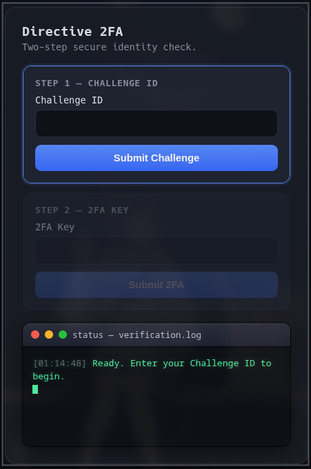

# Directive 2FA

Framework de autenticación de dos factores (2FA) para Hermes Agent con reacción automática del agente vía gateway notification.

## Características

- **Cleanup inicial automático** — Limpia procesos y archivos huérfanos antes de cada challenge
- **Reacción automática** — El agente Hermes reacciona automáticamente cuando se completa el 2FA
- **Webform "Directive 2FA"** — Interfaz web con soporte Enter key en ambos pasos
- **Arquitectura desacoplada** — `2fa-challenger` genera challenge, agente lanza `2fa-wait` directamente
- **Auditoría inmutable** — Log en `executed.log` con timestamp, acción y nonce
- **Cleanup post-confirmed** — `2fa-wait` limpia automáticamente al finalizar

## Flujo

```
1. Agente: python3 2fa-challenger "acción_sensible"
2. Challenger: cleanup inicial (mata huérfanos, borra pending/, tokens/, /tmp/2fa-result-*)
3. Challenger: crea challenge + nonce → pending/<challenge>.json
4. Challenger: lanza poller + webform → imprime JSON {challenge, nonce} → EXIT
5. Agente: captura challenge+nonce → lanza 2fa-wait <nonce> (background, notify_on_complete=true)
6. Usuario: resuelve en webform (Enter key) o SSH (2fa-validator)
7. Poller: detecta token → ejecuta acción → write executed.log → EXIT
8. 2fa-wait: detecta executed.log → CONFIRMED → cleanup final → EXIT 0
9. Gateway: notifica al agente (proceso terminó)
10. Agente: REACCIONA AUTOMÁTICAMENTE
```

## Archivos

```
Directive-2FA/
├── scripts/
│   ├── 2fa-challenger      # Genera challenge, lanza poller+webform
│   ├── 2fa-poller          # Espera token, ejecuta acción, log
│   ├── 2fa-validator       # Verifica clave (Argon2id) → token
│   ├── 2fa-wait            # Espera executed.log, cleanup, notifica
│   ├── 2fa-stop-childs     # Lifecycle manager (start/stop poller+webform)
│   ├── terminal_2fa.py     # Bridge PTY para validador terminal
│   └── webform_server.py   # Web UI "Directive 2FA" (puerto _2FA_WEB_PORT)
├── skill/
│   ├── SKILL.md            # Skill directive-2fa para Hermes
│   └── references/         # Documentación adicional
└── docs/
```

## Instalación

```bash
cd Directive-2FA
./install.sh
```

El script `install.sh`:
- Copia scripts a `~/.hermes/2fa/`
- Instala skill en `~/.hermes/skills/directive-2fa/`
- Crea directorios `pending/`, `tokens/` con permisos correctos
- Verifica sintaxis de todos los scripts

## Variables de entorno requeridas

```bash
# En ~/.hermes/.env
_2FA_WEB_PORT=8080          # Puerto webform (opcional, default: efímero)
2FA_SECRET=<argon2id_hash>  # Hash Argon2id de la clave maestra
SUDO_PASSWORD=<password>    # Para sudo-command (opcional)
HERMES_SESSION_ID=<id>      # Inyectado automáticamente por Hermes
```

## Uso

```bash
# Desde el agente (automático):
python3 ~/.hermes/2fa/2fa-challenger "acción_requerida_2fa"

# Manual (testing):
python3 ~/.hermes/2fa/2fa-challenger "test-manual"
# → captura challenge+nonce
python3 ~/.hermes/2fa/2fa-wait <nonce> 295
# → resuelve en webform o SSH
```

## Webform

- URL: `http://<host>:<_2FA_WEB_PORT>/`
- Título: **Directive 2FA** (pestaña + header)
- Step 1: Challenge ID → **Enter** para enviar
- Step 2: 2FA Key → **Enter** para validar

## Webform UI



*Webform Directive 2FA: STEP 1 – CHALLENGE ID activo, con campos Challenge ID y 2FA Key y soporte Enter key.*

## Seguridad

- Clave 2FA nunca se loguea ni expone (solo viaja form → PTY → validador)
- Pending files: modo 600, TTL 5 min
- Tokens: modo 600, borrados tras uso
- HMAC SHA256 para webhooks (si se usan)
- Bracket-safe pkill para evitar matar al propio proceso

## Requisitos

- Python 3.10+
- Argon2 (`pip install argon2-cffi`)
- Hermes Agent con gateway notification habilitado
- Linux (probado en CachyOS/Arch)

## Licencia

MIT